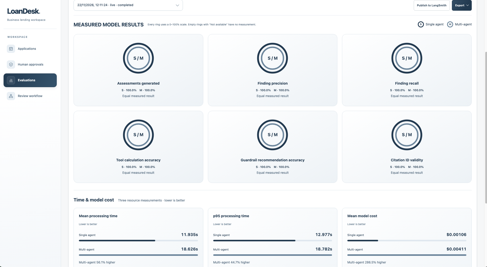

# LoanDesk

An AI-assisted business lending review workspace built with **LangGraph, LangChain, FastAPI and React**. LoanDesk compares one generalist agent with a supervisor-led team of three parallel specialists, using shared evidence, financial tools, policy and human approval requirements.

## Evaluation matrix



The dashboard compares assessment completion, finding precision and recall, calculation accuracy, recommendation accuracy, citation validity, latency and estimated model cost. The screenshot records an existing experiment; results depend on the model, configuration and cases used.

## What it does

- Create applications, attach documents and track review status.
- Run document, financial and policy specialists in parallel, then synthesize one assessment.
- Keep a person in control through revision-bound approval, change requests and rejection.
- Inspect model activity, source evidence, usage and LangSmith traces.
- Compare both architectures on the same labeled cases and export CSV or JSON results.

## Run locally

Follow [the developer guide](developer-guide/README.md#local-setup) to install dependencies and configure MongoDB and provider credentials. Then run each command in a separate terminal from the project root:

```sh
bash backend/scripts/run-single-agent.sh
```

```sh
bash backend/scripts/run-multi-agent.sh
```

```sh
npm --prefix frontend run dev
```

Open **http://localhost:5173**. Use the header switch to select the architecture. Model execution requires the independent server enable flag and a valid key; clicking a run action may incur provider charges.

## Stack

React · TypeScript · Redux Toolkit / RTK Query · Python · FastAPI · LangGraph · LangChain · MongoDB · LangSmith

All implementation details, setup, configuration, workflow diagrams, evaluation methodology and verification commands live in **[one developer guide](developer-guide/README.md)**.

This is a portfolio application using fictional policy and synthetic evaluation cases. It prepares assessments for human review; it does not issue credit or move funds.
